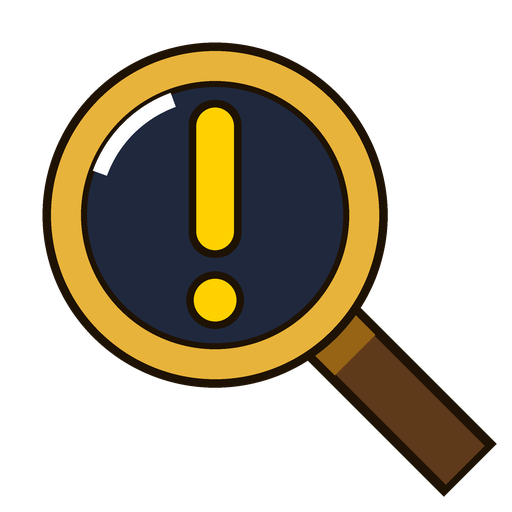

<p align="center"></p>

<h1 align="center">Wowhead Forever Link</h1>

<p align="center">
Open <a href="https://www.wowhead.com/forever/">Wowhead (WoW Forever)</a> for any NPC's loot or any quest, straight from the game.<br>
<a href="#español">Leer en español</a>
</p>

<p align="center">
<a href="https://github.com/AlexDXC2026/WowheadForeverLink/actions/workflows/ci.yml"></a>
<a href="https://github.com/AlexDXC2026/WowheadForeverLink/releases/latest"></a>
<a href="LICENSE"></a>
</p>

---

> **Fan project, work in progress.** Wowhead Forever Link is made by a fan in spare time. It is not an official Wowhead or Blizzard product. It is still being improved: features may change, and you may find bugs or quests with incomplete data (quest requirements come from Questie's database). Reports and ideas are welcome in [issues](https://github.com/AlexDXC2026/WowheadForeverLink/issues).

The project has two parts:

| Part | What it does | Where to get it |
|---|---|---|
| **Addon** | Builds the Wowhead link and shows it ready to copy. | CurseForge, or the `.zip` in [Releases](https://github.com/AlexDXC2026/WowheadForeverLink/releases/latest) |
| **Companion app** (optional, Windows) | Opens every Wowhead link you copy from WoW, in Chrome or in a floating window over the game. | [`WowheadForeverLink-Companion.exe`](https://github.com/AlexDXC2026/WowheadForeverLink/releases/latest/download/WowheadForeverLink-Companion.exe) |

## Addon

- **Right-click a portrait** (target, focus or boss) → **View on Wowhead**.
- **Button next to the target frame**: opens the NPC page on the **Loot** tab (trash, good and quest drops with drop rates). Shift + drag to move it.
- **Quest log**: an icon on every quest and a **Wowhead** button in the quest details.
- **Quest giver window**: an icon next to the close button, to check a quest before accepting it.
- **Questie map icons**: **Alt + click** any quest icon on the world map or minimap to open it on Wowhead. For quests you have not taken, the window also says whether you can take it: level, previous quests (done or missing) and Questie's verdict. **Hovering** a "!" icon shows the same lines in its tooltip.
- **Items**: **Alt + click** an item (bags, chat link, loot window) to open its quest on Wowhead: a quest you have not taken yet first, then one in your log. Items with no such quest open their own page. The tooltip of a quest item shows the hint. Finding the quest needs Questie, and works a few seconds after logging in.
- **Rares (RareScanner)**: the "rare found" alert of RareScanner gets a Wowhead icon in its corner: NPC page on the loot tab, or the container's contents.
- **Key bindings** (Options → Keybindings → AddOns): Wowhead for your target or for the unit under the mouse.
- Links always point to the **Forever** section of Wowhead, in your **client language** (English, Spanish, German, French, Italian, Portuguese, Russian, Korean and Chinese).

| Command | Action |
|---|---|
| `/wh` | Loot of your target |
| `/wh q <id>` | Quest by ID |
| `/wh <text>` | Search Wowhead |
| `/wh last` | Show the last link again |
| `/wh reset` | Move the target button back to its place |
| `/wh diag` | Addon status |
| `/wh app` | Download link of the companion app (.exe) |

A WoW addon cannot open a browser or write to the clipboard. The addon shows the link pre-selected: press **Ctrl+C** and paste it in your browser, or let the companion app open it for you.

## Companion app (optional)

A small Windows program that lives next to the clock. When you copy a Wowhead link **from WoW**, it opens it:

- **Floating window**: on top of the game, without taking focus away from it. The mouse wheel scrolls it; `Ctrl+Shift+W` shows or hides it.
- **Chrome**: in a new Chrome tab (or your default browser).
- **Paused**: does nothing.

Right-click the tray icon to choose the mode, opacity, "always on top", "start with Windows" and the diagnostic log.

- **Nothing to install**: a single `.exe` (.NET included). The floating window uses Microsoft Edge WebView2, which ships with Windows 10 and 11.
- **Safe for your account**: it is a normal window. It does not read, inject into or modify the game.
- **Privacy**: it only reacts to `https://wowhead.com/...` links copied while WoW is the active window. Any other clipboard content is ignored and never stored. No network access except the Wowhead pages you open.
- **Windows SmartScreen** may warn the first time because the app is not code-signed yet: *More info → Run anyway*. You can check the file against the `SHA256SUMS.txt` published with each release.

Settings are stored in `%LOCALAPPDATA%\WowheadForeverLink\config.json` (the shortcut can be changed there).

When a release brings a new `.exe`, the addon tells you once in chat at login; `/wh app` shows the download link.

## Building from source

Requirements: .NET 8 SDK, Node.js 24+, Python 3 with Pillow (only to regenerate the icon).

```bash
# Addon tests (Lua 5.1 syntax + simulated WoW API, in 4 client locales)
cd tests && npm ci && node run.js

# Companion app (single self-contained .exe in dist/companion)
dotnet publish companion -c Release -o dist/companion

# Icon in every size
python assets/make_icon.py
```

See [CONTRIBUTING.md](CONTRIBUTING.md) for the branch, commit and release workflow.

## License

[MIT](LICENSE). Wowhead is a trademark of its owners; this project is not affiliated with Wowhead or Blizzard Entertainment.

---

## Español

Abre **Wowhead (WoW Forever)** con el botín de cualquier PNJ o con cualquier misión, desde el propio juego.

> **Proyecto de fan, en desarrollo.** Lo hace un fan en su tiempo libre; no es un producto oficial de Wowhead ni de Blizzard. Sigue mejorándose: algunas funciones pueden cambiar y puede haber fallos o misiones con datos incompletos (los requisitos salen de la base de datos de Questie). Los avisos e ideas son bienvenidos en [issues](https://github.com/AlexDXC2026/WowheadForeverLink/issues).

**Addon**
- **Clic derecho en un retrato** (objetivo, foco o jefe) → **Ver en Wowhead**.
- **Botón junto al marco del objetivo**: abre la ficha del PNJ en la pestaña **Botín** (normal, bueno y de misión, con porcentajes). Mayús + arrastrar para moverlo.
- **Registro de misiones**: icono en cada misión y botón **Wowhead** en el detalle.
- **Ventana del PNJ que da misiones**: icono junto a la X para revisar la misión antes de aceptarla.
- **Iconos de Questie en el mapa**: **Alt + clic** en cualquier icono de misión del mapa o del minimapa la abre en Wowhead. Si aún no la tienes, la ventana te dice si puedes cogerla: nivel, misiones previas (hechas o pendientes) y el veredicto de Questie. **Al pasar el ratón** por un "!" lo ves en su tooltip.
- **Objetos**: **Alt + clic** en un objeto (bolsas, enlace del chat, ventana de botín) abre su misión en Wowhead: primero una que aún no has cogido, si no una de tu registro. Si no tiene, abre la ficha del objeto. El tooltip de un objeto de misión lo indica. Encontrar la misión necesita Questie y funciona unos segundos después de entrar.
- **Raros (RareScanner)**: el aviso de "raro encontrado" de RareScanner lleva un icono de Wowhead en la esquina: ficha del PNJ en la pestaña de botín, o el contenido del cofre.
- **Atajos de teclado** (Opciones → Atajos → Addons).
- Comandos: `/wh`, `/wh m <id>`, `/wh <texto>`, `/wh ultima`, `/wh reset`, `/wh diag`, `/wh app` (enlace del .exe).
- Los enlaces van siempre a la sección **Forever** de Wowhead, en el **idioma de tu cliente**.

Un addon de WoW no puede abrir el navegador ni copiar al portapapeles: el addon muestra el enlace seleccionado, pulsas **Ctrl+C** y lo pegas en el navegador, o deja que el programa acompañante lo abra solo.

**Programa acompañante (opcional, Windows)**: descarga [`WowheadForeverLink-Companion.exe`](https://github.com/AlexDXC2026/WowheadForeverLink/releases/latest/download/WowheadForeverLink-Companion.exe). Se queda junto al reloj y, cuando copias un enlace de Wowhead **desde WoW**, lo abre en una **ventana flotante** encima del juego (sin quitarle el foco; `Ctrl+Shift+W` la muestra u oculta) o en **Chrome**. Se elige con clic derecho en su icono.

- No hay que instalar nada: es un único `.exe`.
- No toca el juego: es una ventana normal de Windows.
- Solo reacciona a enlaces de `wowhead.com` copiados con WoW en primer plano; el resto del portapapeles se ignora y nunca se guarda.
- Windows SmartScreen puede avisar la primera vez porque aún no está firmado: *Más información → Ejecutar de todas formas*. Puedes comprobar el archivo con `SHA256SUMS.txt` de cada versión.
