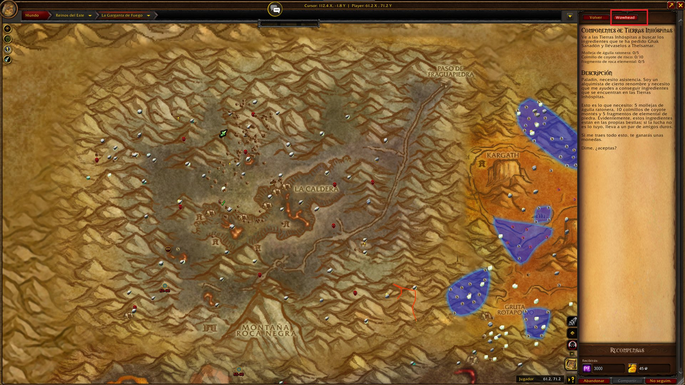
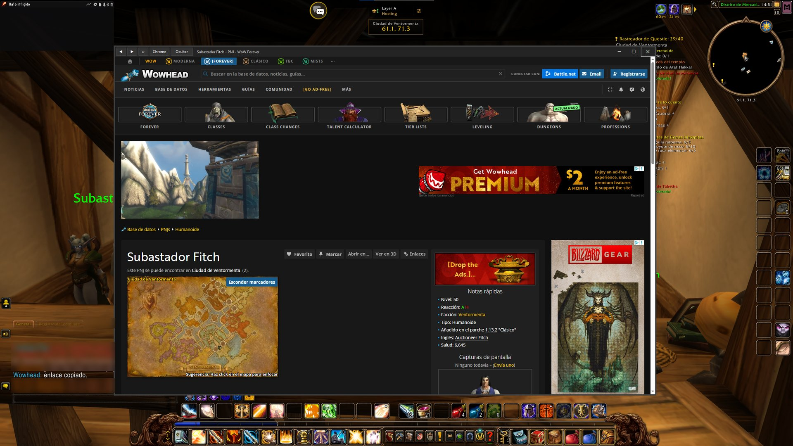

# Wowhead Forever Link

**Open Wowhead (WoW Forever) for any quest or any NPC's loot, straight from the game.**

## How it works: click, Ctrl+C, done

1. Click a **Wowhead** button: in the quest log, in the quest details on the map, next to your target, or right-click a portrait.
2. A small window shows the Wowhead link **already selected**: always the **Forever** section, in **your client language**.
3. Press **Ctrl+C**. The chat confirms *"Wowhead: link copied."*

**Why Ctrl+C?** WoW addons cannot open a browser or write to the clipboard. No addon can. With the addon alone, after Ctrl+C you paste the link in your browser. The companion app below opens it for you.

## ⭐ Strongly recommended: the free companion app (.exe)

With the companion app, **Ctrl+C is all you do**: the Wowhead page opens by itself in a **floating window on top of the game**, like the Steam overlay. No alt-tab, no pasting.

### **[⬇ Download WowheadForeverLink-Companion.exe](https://github.com/AlexDXC2026/WowheadForeverLink/releases/latest/download/WowheadForeverLink-Companion.exe)**

- **`Ctrl+Shift+W` shows or hides the floating window**, also while you play. The window's **Hide** button does the same.
- Single `.exe`, nothing to install. Run it and it waits next to the clock.
- Right-click its icon next to the clock to choose: **floating window** or **Chrome**.
- The floating window never takes focus away from the game. The mouse wheel scrolls it.
- Another program already uses `Ctrl+Shift+W`? Change the shortcut in `%LOCALAPPDATA%\WowheadForeverLink\config.json`.
- Safe: it is a normal Windows window. It never reads, injects into or modifies the game. It only reacts to wowhead.com links copied while WoW is the active window; anything else on your clipboard is ignored and never stored.
- Open source (MIT). Each release publishes SHA-256 checksums. Windows SmartScreen may warn because the app is not code-signed yet: *More info → Run anyway*.

It is a Windows program, so CurseForge cannot host it: it is published on [GitHub](https://github.com/AlexDXC2026/WowheadForeverLink), next to the source code.

> **Fan project, work in progress.** Wowhead Forever Link is made by a fan in spare time. It is not an official Wowhead or Blizzard product. It is still being improved: features may change, and you may find bugs or quests with incomplete data (quest requirements come from Questie's database, plus the pre-quests the addon adds where Questie misses them). If something looks wrong, please report it on [GitHub](https://github.com/AlexDXC2026/WowheadForeverLink/issues).

## Where the Wowhead buttons are

- **Quest log**: an icon on every quest, plus a **Wowhead** button in the quest details.
- **Quest giver window**: check a quest on Wowhead before accepting it.
- **Right-click a portrait** (target, focus or boss) → **View on Wowhead**.
- **Button next to the target frame**: opens the NPC page on the **Loot** tab — trash, good and quest drops with their drop rates. *Shift + drag* to move it.
- **Questie map icons**: **Alt + click** a quest icon on the map or minimap to open it on Wowhead, and see right away if you can take it: required level and previous quests, each marked done or missing. Just **hovering** a "!" shows it in the tooltip.
- **Items**: **Alt + click** an item (bags, chat link, loot window) to open its quest on Wowhead: one you have not taken yet first, then one in your log. Other items open their own page. Needs Questie.
- **Rares (RareScanner)**: RareScanner's "rare found" alert gets a Wowhead icon: NPC loot, or the container's contents.
- **Key bindings** (game key bindings, *Wowhead Forever Link* section): Wowhead for your target, or for whatever is under the mouse.
- **Client language**: English, Español, Deutsch, Français, Italiano, Português, Русский, 한국어, 中文.
- Works in combat and instances whenever the game allows reading the unit; otherwise it falls back to what it read when you targeted it.

## Commands

| Command | Action |
|---|---|
| `/wh` | Loot of your target |
| `/wh q <id>` | Quest by ID |
| `/wh <text>` | Search Wowhead |
| `/wh last` | Show the last link again |
| `/wh reset` | Move the target button back to its place |

## Feedback

This is a fan project that keeps improving with your reports. Bugs, wrong quest data and ideas: [GitHub issues](https://github.com/AlexDXC2026/WowheadForeverLink/issues).

*Not affiliated with Wowhead or Blizzard Entertainment.*

---

## Español

**Abre Wowhead (WoW Forever) con cualquier misión o el botín de cualquier PNJ, desde el juego.**

### Cómo funciona: clic, Ctrl+C y listo

1. Pulsa un botón **Wowhead**: en el registro de misiones, en los detalles de misión del mapa, junto a tu objetivo, o clic derecho en un retrato.
2. Sale una ventanita con el enlace de Wowhead **ya seleccionado**: siempre la sección **Forever**, en el **idioma de tu cliente**.
3. Pulsa **Ctrl+C**. El chat confirma *"Wowhead: enlace copiado."*

**¿Por qué Ctrl+C?** Ningún addon de WoW puede abrir el navegador ni escribir en el portapapeles. Solo con el addon, tras Ctrl+C pegas tú el enlace en el navegador. El programa acompañante lo abre por ti.

### ⭐ Muy recomendado: el programa acompañante gratuito (.exe)

Con el programa acompañante **solo pulsas Ctrl+C**: la página de Wowhead se abre sola en una **ventana flotante encima del juego**, como la superposición de Steam. Sin alt-tab y sin pegar nada.

**[⬇ Descargar WowheadForeverLink-Companion.exe](https://github.com/AlexDXC2026/WowheadForeverLink/releases/latest/download/WowheadForeverLink-Companion.exe)**

- **`Ctrl+Shift+W` muestra u oculta la ventana flotante**, también mientras juegas. El botón **Ocultar** de la ventana hace lo mismo.
- Un único `.exe`, sin instalar nada. Lo abres y espera junto al reloj.
- Clic derecho en su icono junto al reloj para elegir: **ventana flotante** o **Chrome**.
- La ventana flotante nunca le quita el foco al juego. La rueda del ratón la desplaza.
- ¿Otro programa ya usa `Ctrl+Shift+W`? Cambia el atajo en `%LOCALAPPDATA%\WowheadForeverLink\config.json`.
- Seguro: es una ventana normal de Windows. Nunca lee, inyecta ni modifica el juego. Solo reacciona a enlaces de wowhead.com copiados con WoW en primer plano; lo demás del portapapeles lo ignora y no lo guarda.
- Código abierto (MIT). Cada versión publica sumas SHA-256. Windows SmartScreen puede avisar porque aún no está firmado: *Más información → Ejecutar de todas formas*.

Es un programa de Windows, así que CurseForge no puede alojarlo: se publica en [GitHub](https://github.com/AlexDXC2026/WowheadForeverLink), junto al código.

> **Proyecto de fan, en desarrollo.** Lo hace un fan en su tiempo libre; no es un producto oficial de Wowhead ni de Blizzard. Sigue mejorándose: algunas funciones pueden cambiar y puede haber fallos o misiones con datos incompletos (los requisitos salen de la base de datos de Questie, más las previas que el addon añade donde Questie no las tiene). Si ves algo raro, avísalo en [GitHub](https://github.com/AlexDXC2026/WowheadForeverLink/issues).

### Dónde están los botones de Wowhead

- **Registro de misiones** y **ventana del PNJ**: icono para ver la misión en Wowhead.
- **Clic derecho en un retrato** → **Ver en Wowhead**.
- **Botón junto al marco del objetivo**: ficha del PNJ en la pestaña **Botín** (normal, bueno y de misión, con porcentajes). *Mayús + arrastrar* para moverlo.
- **Iconos de Questie en el mapa**: **Alt + clic** abre la misión en Wowhead y te dice si puedes cogerla (nivel y misiones previas hechas o pendientes). Con solo **pasar el ratón** por un "!" lo ves en el tooltip.
- **Objetos**: **Alt + clic** en un objeto (bolsas, enlace del chat, ventana de botín) abre su misión en Wowhead. Si no tiene, abre la ficha del objeto. Necesita Questie.
- **Raros (RareScanner)**: el aviso de "raro encontrado" lleva un icono de Wowhead.
- **Atajos de teclado** (atajos del juego, sección *Wowhead Forever Link*): Wowhead de tu objetivo o de lo que hay bajo el ratón.
- Comandos: `/wh`, `/wh m <id>`, `/wh <texto>`, `/wh ultima`, `/wh reset`.
